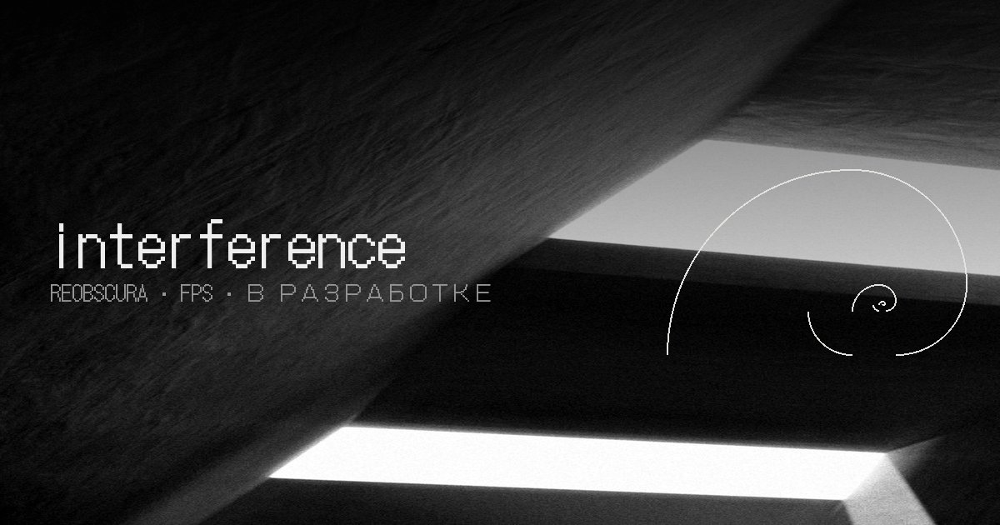
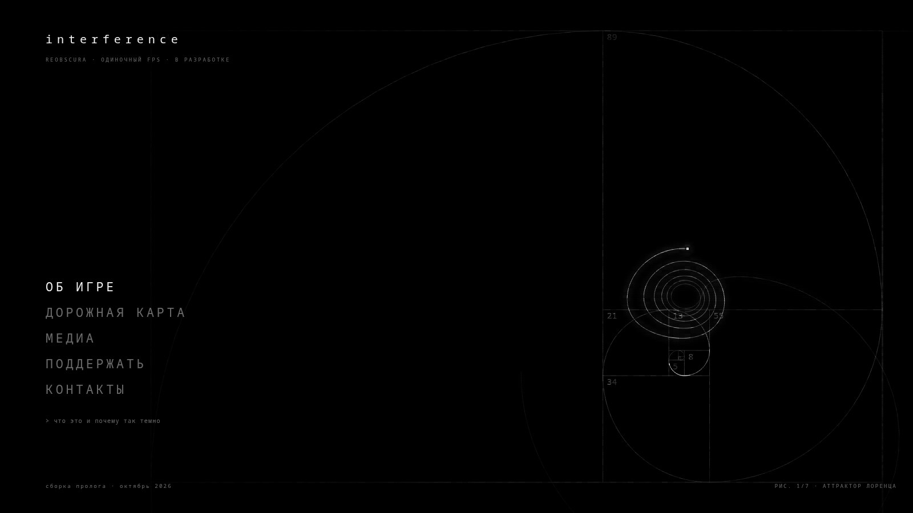
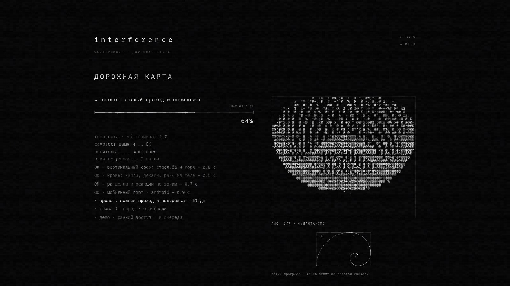

<div align="center">



**https://re-obscura.github.io/interference/**

```text
reobscura · чб-терминал 1.0
самотест памяти …… ОК
носитель ………… подключён
сайт ………………… онлайн
```

</div>

---

интерференция — наложение волн. когда сигналов слишком много, из шума проступает картина.

этот сайт — не лендинг по шаблону. каждый его слой — порт настоящего главного меню игры **interference** (godot 4.7), собранный вручную: те же формулы, те же размеры, тот же шрифт.

<div align="center">

| главное меню | дорожная карта |
|:---:|:---:|
|  |  |

</div>

---

## · что внутри

семь математических сцен сменяют друг друга каждые 16 секунд — аттрактор лоренца, филлотаксис, тор, сфера π, тессеракт, морфящийся торус-узел и множество жюлиа. золотая спираль из 14 квадратов с числами фибоначчи несёт фосфорную точку с хвостом; при переходе в раздел она проворачивается на 90° с зумом φ — «погружение» из игры, один-в-один.

поверх всего — CRT: скан-линии, зерно плёнки, глитч-полосы при смене сцен, мерцание старого монитора и скрэмбл-декод текста знаками `0123456789πΣ∫φ`. дорожная карта оформлена экраном загрузки игры — знаковое поле с послесвечением и рампой ` .,:;+*x%#@`, терминальный лог, волосяные шкалы и сердцебиение в «глазе» спирали.

```text
ОК · главное меню   — 7 сцен · спираль · погружение · подсказки
ОК · об игре        — системы с волосяными шкалами прогресса
ОК · дорожная карта — терминал погрузки · 7 шагов до раннего доступа
ОК · медиа          — кадры из сборок · без цветокоррекции
·· · поддержка      — донаты и зачем они
·· · контакты       — почта · телеграм · пресса
```

## · управление

```text
↑ ↓      выбор пункта          enter    переход
[ ]      сцена назад/вперёд    1–7      выбрать сцену
```

## · как устроено

```text
index.html      разметка разделов · контент · метаданные
css/style.css   типографика и CRT-слои · кегли из main_menu.gd
js/scenes.js    семь сцен и знаковое поле — порт _scene_* и _fig_*
js/fx.js        скрэмбл-движок · спираль · cubic-bezier · сердцебиение
js/main.js      кадр · погружение · дорожная карта · данные (SYS, ROADMAP)
fonts/          субсеты DotGothic16 · VT323 · Pixelify Sans
img/            кадры из игры · og-картинка · фавиконки
docs/           скриншоты сайта
```

тексты дорожной карты и прогресс систем живут в начале `js/main.js` — массивы `ROADMAP` и `SYS`; проценты, фигуры и счётчики шагов пересчитываются сами.

## · шрифты

DotGothic16 (fontworks), VT323 и Pixelify Sans распространяются по SIL OFL 1.1 — лицензии лежат в `fonts/OFL-*.txt`. в интерфейсе игры DotGothic16 основной шрифт: в нём есть и кириллица, и πΣ∫φ.

---

<div align="center">

```text
© 2026 reobscura · interference · 18+
мерцающие изображения · сцены насилия · повторяющиеся паттерны
```

</div>
